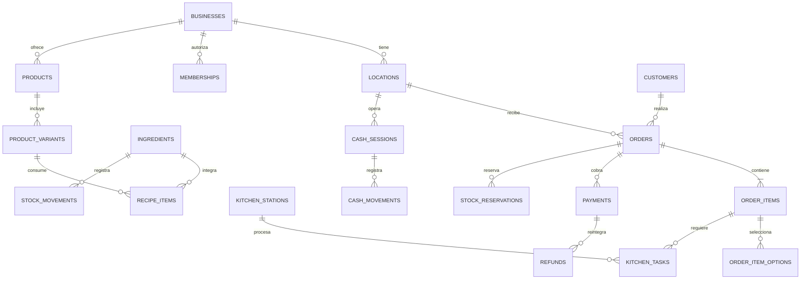

# Arquitectura propuesta y base implementada

## Estado actual

La app Next.js incluye registro/login/logout con Neon Auth, alta de negocios, carta manual/importada con OpenAI, configuración y publicación de tienda, carrito y pedidos pendientes con resumen de WhatsApp y aceptación en el panel. Drizzle versiona `businesses`, `locations`, `memberships`, `menu_products`, `store_settings`, `menu_imports` y `orders`. Cocina, caja, stock y otras entidades de este diseño siguen pendientes. Ver [Alta](./ALTA-NEGOCIOS.md) y [Carta y tienda](./CARTA-TIENDA.md).

Neon está vinculado a la organización `org-proud-voice-23148089`, proyecto `soft-tooth-38969404`, rama `production` (`br-empty-resonance-b5ar105u`). `neon.ts` y `neon deploy` gestionan Postgres y Neon Auth. Neon no publica el frontend: el hosting de la app sigue pendiente.

## Stack y razones

| Capa              | Elección                                                               | Razón                                                                                     |
| ----------------- | ---------------------------------------------------------------------- | ----------------------------------------------------------------------------------------- |
| Aplicación        | Next.js App Router + TypeScript, runtime Node.js                       | Tienda, panel y API en un mismo proyecto, con componentes de servidor por defecto         |
| Base              | Postgres en Neon                                                       | Transacciones, restricciones y branches para probar migraciones                           |
| Driver actual     | `pg` con `DATABASE_URL` pooled                                         | Soporta servidor Node persistente y transacciones interactivas para pedidos, caja y stock |
| Ciclo de pool     | Pool pequeño, reutilizado; `attachDatabasePool` en Vercel              | Evitar una conexión nueva por consulta y manejar suspensión en Fluid compute              |
| Variables         | `@neon/env` con validación diferida                                    | El build no necesita conectarse a la DB; el request valida la configuración real          |
| Esquema actual    | Drizzle con migraciones SQL versionadas                                | Esquema inicial de negocios, sucursales y membresías; SQL revisable                       |
| Identidad actual  | Neon Auth / Managed Better Auth                                        | Sesiones administradas; pertenencias y propietario resueltos por la aplicación            |
| Fotos futuras     | Almacenamiento de objetos, preferentemente Neon si la región lo admite | Cargas firmadas, límites de peso y tipo; Postgres solo conserva referencias               |
| Cocina V1         | Polling incremental cada 3–5 s mientras esté visible                   | Sencillo de operar y probar; medir carga antes de agregar SSE o Realtime                  |
| Hosting propuesto | Vercel con Node/Fluid; región cercana a la DB                          | Alternativa: servidor Node en Render/Railway/VPS. No hay despliegue web aún               |

Para esta arquitectura se siguió la recomendación actual de Neon de usar `pg` en Node y Vercel Fluid. Si se elige Workers sin Hyperdrive o Netlify, se debe revisar el driver; no desplegar este pool TCP como si fuera código Edge.

## Estructura

```text
neon.ts                     Infraestructura Neon generada por la CLI
src/app/                    Página inicial, estilos y route handlers
src/app/api/health/db/       Consulta real, de solo lectura, a Postgres
src/components/             Interacciones pequeñas del navegador
src/server/postgres.ts      Pool y validación de variables; solo servidor
scripts/test-db.ts          CRUD temporal y rollback contra Postgres
scripts/test-e2e.mjs        Prueba HTTP de la app iniciada
scripts/test-browser.mjs    Prueba de interacción, móvil y captura de pantalla
docs/                       Alcance, diseño, backlog y evidencia
```

Al iniciar el dominio, organizar por módulos `catalog`, `orders`, `payments`, `inventory`, `kitchen`, `cash` y `tenancy`. Cada módulo tiene reglas de dominio, repositorio y adaptador HTTP. Las páginas no ejecutan reglas financieras directamente. No hacen falta microservicios para el piloto.

## Modelo de datos propuesto

Todas las entidades propias de un negocio incluyen `business_id`. Las entidades operativas también incluyen `location_id`. Las relaciones compuestas impiden vincular, por error, un pedido de un negocio con un producto de otro.

| Área       | Tablas propuestas                                                                                                         | Datos / invariantes                                                           |
| ---------- | ------------------------------------------------------------------------------------------------------------------------- | ----------------------------------------------------------------------------- |
| Acceso     | `businesses`, `locations`, `memberships`, `invitations`                                                                   | Slug único, zona horaria, usuario, rol; sesiones gestionadas por el proveedor |
| Carta      | `categories`, `products`, `product_variants`, `option_groups`, `options`, `product_option_groups`, `combo_components`     | Precios, mínimos/máximos, disponibilidad, unidad de venta                     |
| Horarios   | `opening_hours`, `special_closures`, `delivery_zones`                                                                     | Días, cruces de medianoche, modalidad, tarifa y mínimo                        |
| Clientes   | `customers`, `customer_addresses`                                                                                         | Identidad por teléfono dentro de un negocio; datos mínimos                    |
| Pedidos    | `orders`, `order_items`, `order_item_options`, `order_events`, `order_number_counters`                                    | Totales y nombres capturados, estados, versión, referencia por negocio        |
| Pagos      | `payments`, `refunds`                                                                                                     | Libro de eventos, importes positivos, idempotencia y conciliación             |
| Cocina     | `kitchen_stations`, `kitchen_tasks`                                                                                       | Tarea por ítem/estación, estado, fechas y tiempos prometidos                  |
| Inventario | `ingredients`, `recipes`, `recipe_items`, `stock_balances`, `stock_reservations`, `stock_movements`, `production_batches` | Unidades exactas, reserva, consumo y movimientos inmutables                   |
| Caja       | `cash_registers`, `cash_sessions`, `cash_movements`                                                                       | Turno, fondo, movimientos, esperado, declarado y diferencia                   |
| Gestión    | `suppliers`, `expenses`, `discounts`                                                                                      | Proveedores y gastos simples, descuentos con reglas claras                    |
| Fiabilidad | `idempotency_keys`, `outbox_events`, `audit_events`                                                                       | Unicidad de comandos, efectos posteriores, trazabilidad                       |



Este diagrama resume relaciones; no es el esquema ejecutado y omite algunas tablas de la lista.

### Tipos, restricciones e índices

- PK internas UUID; `business_id` y FKs requeridas. Borrado lógico de catálogo usado en ventas; no cascadas que borren registros financieros.
- Dinero `bigint` en centavos y manejo con `bigint`/decimal sin pérdida; al serializar usar strings si supera el rango seguro de JS. Cantidades y conversiones `numeric`, nunca coma flotante para cálculos monetarios.
- Fechas `timestamptz` en UTC. Jornada operativa local calculada con zona horaria y hora de corte del negocio, independiente de la fecha UTC.
- Restricciones para cantidades positivas, precios no negativos y saldo/total coherente. Estados permitidos en DB; transiciones en el dominio.
- Unicidad `(business_id, order_number)` y `(business_id, idempotency_key, operation)`. Guardar hash del payload para rechazar reutilización de clave con otro carrito.
- Índices iniciales: pedidos `(business_id, location_id, status, created_at)`; tareas `(business_id, station_id, status, created_at)`; movimientos `(business_id, ingredient_id, created_at)`; clientes `(business_id, normalized_phone)`.
- Asignar número con contador por negocio actualizado atómicamente. No exigir numeración fiscal ni ausencia absoluta de huecos para una referencia operativa.

## Aislamiento y autorización

1. Verificar sesión en cada acción y endpoint privado.
2. Resolver la pertenencia al negocio y permisos en el servidor; un `business_id` recibido del cliente no es autorización.
3. Consultas siempre acotadas por negocio y sucursal permitida; DTO públicos de carta y seguimiento con campos explícitos.
4. Antes del piloto: rol de aplicación de mínimo privilegio, distinto del propietario/migrador. RLS como segunda barrera, con `FORCE ROW LEVEL SECURITY` donde corresponda y pruebas con el rol real sin `BYPASSRLS`.
5. Contexto de negocio dentro de cada transacción mediante `set_config(..., true)` o equivalente local; no `SET` de sesión persistente en un pool compartido.
6. La DB no se consulta desde el navegador ni se exponen variables de conexión con `NEXT_PUBLIC_`. Secretos de despliegue se configuran por entorno.

El alta y el panel ya validan sesión y pertenencia en el servidor. El cliente no puede elegir el usuario propietario ni el rol. RLS y el rol de base de mínimo privilegio siguen pendientes; el aislamiento actual se implementa en consultas parametrizadas por usuario autenticado, y debe seguir extendiéndose a cada módulo nuevo.

## Transacciones y concurrencia

**Crear checkout:** validar entrada → resolver carta vigente → calcular importes → insertar pedido, ítems, opciones e idempotencia en una transacción → devolver referencia, token de seguimiento y mensaje WhatsApp. El enlace se abre después de persistir. Un reintento devuelve el mismo pedido.

**Aceptar pedido:** bloquear pedido por negocio (`FOR UPDATE`) → verificar versión/estado → bloquear existencias requeridas en orden estable → validar stock libre → reservar → crear tareas de cocina y evento de auditoría → confirmar transacción. La cocina solo consulta tareas confirmadas.

**Iniciar preparación:** consumir la reserva una sola vez y registrar movimientos. Si varios ítems comparten insumos, actualizar en una transacción y con una clave de operación única.

**Cobrar:** bloquear pedido y turno → verificar saldo y caja abierta → registrar cobro y movimiento relacionado de forma atómica → incrementar versión → confirmar. Un reintento no añade otro cobro. Reintegros referencian cobros reales y no exceden su importe neto.

**Efectos posteriores:** notificaciones, impresión y exportaciones fuera de la transacción, mediante outbox cuando sean automáticos. En V1 WhatsApp es una acción del usuario; no enviar mensajes automáticamente.

## API propuesta

| Superficie       | Rutas orientativas                                                         | Controles                                            |
| ---------------- | -------------------------------------------------------------------------- | ---------------------------------------------------- |
| Carta pública    | `GET /api/storefront/:slug`                                                | Campos públicos, disponibilidad y caché invalidable  |
| Checkout         | `POST /api/storefront/:slug/orders`                                        | Validación, límites, idempotencia; total en servidor |
| Seguimiento      | `GET /api/tracking/:token`                                                 | Token opaco y respuesta reducida; sin enumeración    |
| Pedidos internos | `GET /api/businesses/:id/orders`, `POST .../:orderId/accept`, `.../cancel` | Sesión, rol, pertenencia, versión                    |
| Cocina           | `GET .../kitchen/tasks`, `POST .../tasks/:id/start`, `.../finish`          | Rol cocina, cursor de cambios y versión              |
| Caja y stock     | Comandos específicos de apertura, cobro, cierre, merma y recepción         | Permisos, motivo y transacción                       |

Además del diagnóstico `GET /api/health/db`, están implementados el proxy de Auth y `GET/POST /api/businesses`, `GET /api/businesses/:id`. Los endpoints de negocios exigen sesión, validan campos en servidor, acotan consultas al usuario y no tienen caché. El POST exige mismo origen, limita el cuerpo a 8 KiB y crea negocio, sucursal y propietario en una transacción. Los errores no exponen SQL ni credenciales. El diagnóstico ejecuta `SELECT 1`; antes de exponerlo públicamente con tráfico real, limitar su frecuencia.

## Operación y despliegue futuros

- Desarrollo con branch Neon aislada; migraciones revisadas y probadas allí antes de producción. Se mantuvo `production` en esta entrega porque el usuario lo indicó; las pruebas no crean tablas comerciales.
- `DATABASE_URL` pooled para la app; `DATABASE_URL_UNPOOLED` para migraciones y procesos que necesitan sesión directa.
- CI: build, tipos, dominio, integración y navegador; entornos de preview con datos sintéticos.
- Logs estructurados con request ID, negocio y tipo de operación; sin dirección, teléfono, tokens ni URLs de conexión.
- Alertas de errores, tiempo de checkout, antigüedad de pendientes, sincronización de cocina y fallos del proceso periódico.
- Definir RPO/RTO con el piloto; verificar la retención contratada y hacer una recuperación ensayada. La existencia de Neon no demuestra por sí sola que la recuperación operativa esté resuelta.
- Reversión de frontend y migraciones compatibles con la versión anterior. Preferir migraciones aditivas; datos reales no se resetean para corregir un deploy.

## Fuentes técnicas

- Guías instaladas de `neon` y `neon-postgres`, consultadas durante el setup.
- [Elegir driver según el entorno](https://neon.com/docs/connect/choose-connection)
- [Pooling de conexiones](https://neon.com/docs/connect/connection-pooling)
