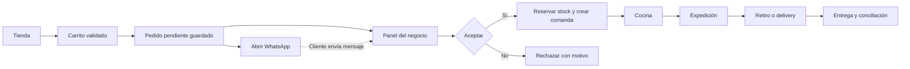
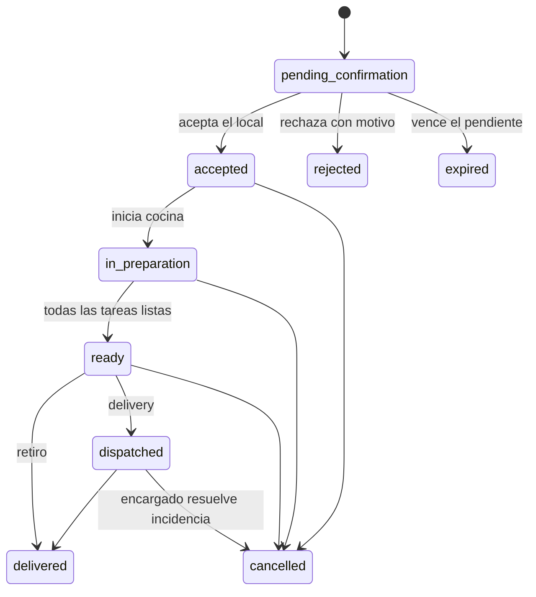

# Sistema gastronómico — propuesta de V1

Estado al 16 de octubre de 2026: alta de cuentas/negocios, carta, configuración y publicación de tienda, checkout por WhatsApp y bandeja de pedidos implementados. Ver [Alta](./ALTA-NEGOCIOS.md) y [Carta y tienda](./CARTA-TIENDA.md) para el estado real y sus límites; este documento conserva el alcance objetivo de V1, incluida cocina, caja y stock aún pendientes.

## 1. Qué vamos a construir

Una plataforma web para que pequeños negocios gastronómicos vendan desde su propia tienda y gestionen pedidos, caja, catálogo, stock y cocina en un mismo lugar. El primer piloto será con una hamburguesería, una rotisería y una casa de pastas de amigos del fundador.

La unidad del sistema es el **negocio**: cada emprendimiento tiene su marca, WhatsApp, catálogo, equipo, clientes y datos separados. Una persona puede administrar varios negocios con permisos independientes. La V1 opera con una sucursal por negocio; el modelo contempla sucursales para evitar rehacer pedidos, stock y caja más adelante.

Nombre comercial pendiente. “Gastronomía” es solamente un nombre de trabajo.

### Decisiones tomadas y supuestos

| Tema                  | Propuesta / decisión                                                             | Estado                                                    |
| --------------------- | -------------------------------------------------------------------------------- | --------------------------------------------------------- |
| Base de datos         | Postgres en Neon, proyecto `soft-tooth-38969404`                                 | Indicado por el usuario                                   |
| Checkout              | Guardar pedido → abrir WhatsApp con resumen → negocio confirma en panel → cocina | Confirmado por el usuario                                 |
| Tipo de producto      | Plataforma para negocios independientes, con datos aislados                      | Supuesto para validar con el piloto                       |
| Moneda y zona horaria | ARS; `America/Argentina/Cordoba`, configurables por negocio                      | Supuesto inicial                                          |
| Entrega               | Retiro y delivery propio, con cargo por zona                                     | Propuesta                                                 |
| Cobro inicial         | Efectivo y transferencia con verificación manual                                 | Propuesta                                                 |
| Uso                   | Web responsive; tienda en celular, gestión en PC/tablet, cocina en tablet        | Propuesta                                                 |
| Alcance actual        | Plan de V1 + base Neon + cuentas, alta de negocios y panel del propietario       | Los módulos operativos se construyen en próximas entregas |

## 2. Recorrido principal

1. El dueño configura horarios, WhatsApp, retiro/delivery, medios de pago y su carta.
2. Comparte el enlace de su tienda o un QR.
3. El cliente elige productos, variantes y adicionales. Ve disponibilidad, mínimos y precio final.
4. Completa nombre, teléfono, modalidad, dirección si corresponde, pago y observaciones.
5. El servidor valida el carrito y guarda el pedido con una referencia única y estado `pending_confirmation`.
6. La web muestra la referencia y ofrece abrir WhatsApp con un resumen. Si falla la apertura, permite copiarlo y volver a abrirlo.
7. El negocio ve el pendiente, verifica pago si hace falta, revisa disponibilidad y acepta o rechaza.
8. Al aceptar, se reservan existencias y se crean las comandas. Cocina prepara por estación; expedición controla el pedido completo.
9. Se entrega o despacha, se registra el cobro y el movimiento queda en caja e informes.

**Regla central:** abrir WhatsApp no prueba que el cliente envió el mensaje, no confirma el pago y no confirma el pedido. El sistema informa “Pendiente de confirmación del local”. El pendiente existe en el panel aunque el cliente cierre WhatsApp.

## 3. Módulos incluidos en la V1

### A. Negocios, equipo y permisos

- Alta autogestionada de cuentas y negocios; el propietario completa rubro, WhatsApp, ciudad y dirección opcional. Marca, horarios y otras configuraciones se completarán con el catálogo.
- Usuarios con autenticación, invitaciones y pertenencia a uno o varios negocios.
- Roles: dueño, encargado, caja y cocina. Los permisos se validan en el servidor.
- El dueño gestiona equipo, configuración e informes; encargado opera pedidos y catálogo; caja cobra y maneja su turno; cocina solo ve comandas y notas necesarias.
- Auditoría de cambios de estado, anulaciones, descuentos, ajustes de stock y caja, con actor, fecha y motivo.
- El operador de la plataforma puede dar de alta negocios. No recibe acceso irrestricto a datos de clientes; cualquier soporte excepcional debe quedar autorizado y auditado.

### B. Carta y catálogo

- Categorías ordenables, productos, descripción, foto, precio y disponibilidad.
- Variantes: simple/doble/triple; porción individual/familiar; bandeja de 500 g/1 kg; media docena/docena.
- Grupos de opciones con mínimos y máximos: tipo de pan, cocción, guarnición, salsa, relleno y adicionales con precio.
- Notas por ítem, por ejemplo “sin cebolla”, visibles en la comanda.
- Combos de composición fija o con elecciones limitadas, con receta y precio propios.
- Horarios por categoría o producto, productos agotados y pausa manual inmediata.
- Recetas y costo estimado por variante, incluyendo adicionales y componentes del combo.
- Carga masiva de precios por CSV con vista previa y confirmación; sin duplicar productos.
- Fotos mediante almacenamiento de objetos, por elegir y configurar en la fase de catálogo. No se almacenan binarios dentro de Postgres.

**Ventas por peso:** en tienda se ofrecen presentaciones de peso y precio definidos, por ejemplo bandeja de 500 g. En mostrador se puede ingresar el peso real y calcular el importe con decimales exactos. Un ajuste posterior al checkout requiere acuerdo del cliente y queda auditado; no se cambia silenciosamente el total enviado por WhatsApp.

### C. Tienda online y checkout por WhatsApp

- Ruta pública por negocio, por ejemplo `/t/la-esquina`, con marca, horario, estado abierto/cerrado y medios de entrega.
- Carta pensada para móvil, búsqueda, categorías, detalle de producto y carrito persistido localmente.
- Cliente sin cuenta obligatoria; compra con datos mínimos.
- Retiro o delivery con zonas explícitas, tarifa, mínimo y dirección obligatoria. Fuera de cobertura, se ofrece retiro.
- Horarios de atención, cierres especiales y pausa por saturación. La V1 acepta pedidos para ahora; la programación por franjas queda para V1.1.
- Selección de efectivo o transferencia; alias e instrucciones del negocio. La transferencia queda pendiente hasta revisión del operador.
- Cálculo de vuelto si paga en efectivo; cualquier observación viaja a caja, no se trata como pago recibido.
- Total calculado por el servidor: productos, adicionales, descuento autorizado y envío. Nunca confiar en precios del navegador.
- Clave de idempotencia para que doble toque o reintento no creen dos pedidos.
- Resumen de WhatsApp con referencia, productos, opciones, modalidad, dirección, pago y total. Enlace `wa.me` con teléfono normalizado y texto codificado.
- Página de seguimiento con token opaco, estado y total; no muestra teléfono ni domicilio públicamente. La referencia secuencial por sí sola no da acceso.
- El cliente puede volver a abrir el mensaje del mismo pedido. Se explicita que debe esperar la confirmación del local.
- Pendientes no atendidos generan alerta. Expiración configurable y revisada en un proceso periódico; un pedido expirado no se acepta sin revalidar.

### D. Pedidos y punto de venta

- Bandeja unificada para tienda y mostrador; un pedido por WhatsApp tomado manualmente se carga desde POS con su canal correspondiente.
- Filtros por estado, canal, modalidad y fecha; búsqueda por referencia o cliente.
- Alta rápida desde el catálogo, datos de cliente y notas.
- Aceptación con tiempo estimado, rechazo con motivo, cancelación y registro de quién actuó.
- Control de versión para evitar que dos operadores confirmen, cobren o cambien el mismo pedido a la vez.
- Antes de aceptar: validar que el negocio puede atender, precios acordados y stock disponible. Si el stock cambió, ofrecer alternativa con acuerdo explícito.
- Edición libre mientras está pendiente; una vez aceptado, cambios como enmiendas auditadas, con ajuste de stock, cocina y saldo. No sobrescribir el historial.
- Cupones simples: porcentaje o importe fijo con vigencia, mínimo y límite; en V1 no se combinan promociones entre sí.
- Ticket no fiscal imprimible desde navegador; reimpresión marcada. Automatización ESC/POS se evalúa con el hardware del piloto.

### E. Cocina y expedición

- Monitor de cocina (KDS) por negocio y estación: plancha, freidora, horno, pastas, armado.
- Solo ingresan pedidos aceptados. Los pendientes por WhatsApp no se preparan.
- Tarjetas con referencia, hora prometida, tiempo transcurrido, canal, cantidades, opciones y notas.
- Estado por ítem: pendiente, en preparación, terminado. Para un ítem que requiere varias estaciones se crean tareas separadas.
- Vista de expedición para verificar que todos los componentes estén listos antes de entregar o despachar.
- Aviso sonoro activado mediante una acción del usuario, alerta visual y umbrales de demora configurables.
- Reconexión con recuperación completa, indicador de última sincronización y reintentos seguros. Si se pierde conexión, no mostrar un cambio como confirmado hasta que responda el servidor.
- Historial reciente de completados y corrección con permiso, sin perder el registro original.
- Datos personales reducidos: cocina no necesita acceso al teléfono ni a la dirección del cliente.

### F. Caja, cobros y ventas

- Apertura de turno con fondo inicial, ingresos, egresos con motivo y cierre con arqueo.
- Efectivo, transferencia y tarjeta/QR registrado manualmente; permitir pago dividido y pagos parciales.
- Un comprobante adjunto o una opción “transferencia” no equivale a pago acreditado.
- Libro de cobros y reintegros; anulaciones reversan movimientos con nuevas entradas, sin borrar originales.
- Pedido, preparación, pago y entrega tienen estados separados. “Listo” no significa “pagado”.
- Alertas al intentar entregar con saldo; dueño/encargado puede autorizar venta a cobrar con motivo.
- Totales por canal, medio de pago, productos, hora y día; ticket promedio y cancelaciones.
- Separar ventas confirmadas, cobranzas, efectivo en caja, descuentos y reintegros. Un cierre no puede contar una venta y su cobro dos veces.
- Exportación CSV y tickets no fiscales. Facturación electrónica se aborda como integración separada antes de ofrecerla.

### G. Stock, recetas y costos

- Insumos y productos terminados; unidad base por insumo (g, ml o unidad), con conversiones explícitas para compras.
- Stock por sucursal, mínimo, entradas por compra/producción, merma y ajustes con motivo.
- Recetas por variante y adicionales; combos consumen sus componentes una vez.
- Disponible = existencia física menos reserva. Se reserva al aceptar, se consume al iniciar preparación y se libera si se cancela antes de producir.
- Si se cancela después de consumir, el operador registra merma o recuperación real. El sistema no repone alimentos automáticamente.
- Productos de producción por lote, como pastas o milanesas preparadas: elaborar consume insumos y genera producto terminado. La venta consume el producto terminado; no vuelve a descontar sus ingredientes.
- Costos estimados con un método consistente (propuesta: costo promedio ponderado), fecha de costo y advertencia cuando falten insumos valorizados.
- Margen bruto estimado visible al dueño; no llamarlo ganancia neta si no contempla gastos y demás costos.
- Proveedores simples y gastos categorizados; sin cuentas corrientes, órdenes de compra ni contabilidad completa en V1.

### H. Clientes, configuración e informes

- Clientes identificados dentro de cada negocio por teléfono normalizado; historial y direcciones con acceso por rol.
- No compartir clientes entre negocios ni crear una base de marketing conjunta.
- Horarios con cruce de medianoche: un turno de 20:00 a 01:00 pertenece a la jornada operativa configurada.
- Reportes diarios/semanales, productos más vendidos, ticket promedio, demoras, mermas y costo estimado.
- Exportación de datos del negocio, política de retención y proceso de corrección/eliminación de datos personales.
- Panel del dueño con pedidos activos, ventas confirmadas, cobros, alertas de stock y estado de caja.

## 4. Estados y reglas que no podemos improvisar

| Dimensión       | Estados / reglas                                                                                                   |
| --------------- | ------------------------------------------------------------------------------------------------------------------ |
| Pedido          | Flujo anterior; rechazo, vencimiento y cancelación no cuentan como venta vigente                                   |
| Pago            | `unpaid`, `partially_paid`, `paid`, `partially_refunded`, `refunded`; saldo calculado a partir del libro de cobros |
| Tarea de cocina | `pending`, `in_progress`, `done`, `cancelled`                                                                      |
| Entrega         | `pickup` o `delivery`; repartidor y despacho independientes del pago                                               |
| Stock           | Reserva, consumo, liberación y devolución/merma son movimientos distintos                                          |

- Cambios de precio conservan el precio y el nombre capturados al comprar; no alteran ventas históricas.
- Pendiente: presupuesto con vencimiento configurable. Al aceptar se respeta el total acordado o se exige nueva aceptación del cliente.
- Toda transición valida rol, negocio, estado anterior y versión dentro de una transacción.
- Una operación repetida responde con su resultado original. No duplica comanda, reserva ni cobro.
- Dinero en centavos enteros, cantidades y pesos en decimales exactos. El redondeo se define por línea; suma de líneas + envío − descuento = total.
- La referencia de pedido es consecutiva por negocio; las claves internas son UUID. No usar `MAX(numero) + 1`.
- Cancelación con cobro no devuelve dinero por sí sola: se registra el reintegro y su método real por separado.

## 5. Lo que dejamos para después

| Próxima etapa                                                         | Motivo                                                                                               |
| --------------------------------------------------------------------- | ---------------------------------------------------------------------------------------------------- |
| WhatsApp Business API, chatbot y mensajes automáticos                 | El usuario eligió checkout con mensaje y confirmación manual                                         |
| Mercado Pago con conciliación automática                              | Requiere integración, credenciales por negocio y webhooks idempotentes; cobro manual cubre el piloto |
| Facturación ARCA                                                      | Integración fiscal con un alcance y validación específicos                                           |
| PedidosYa/Rappi y flotas externas                                     | Dependencias comerciales y técnicas ajenas al flujo inicial                                          |
| Salón, mesas, cuentas abiertas y división de mesa                     | Los pilotos se enfocan en retiro y delivery                                                          |
| Múltiples sucursales operativas, franquicias                          | Modelo preparado; interfaz y operación posteriores                                                   |
| Franjas programadas y capacidad por franja                            | Recomendable para pastas, después de validar producción y horarios del piloto                        |
| Fidelización, puntos y marketing automatizado                         | Primero validar operación y recurrencia real                                                         |
| Apps nativas, modo offline con cobros y sincronización                | V1 web con recuperación de conexión; no prometer operación offline                                   |
| Contabilidad integral, nómina, cuentas corrientes y compras avanzadas | Fuera del núcleo operativo de esta V1                                                                |
| Suscripciones y cobro SaaS a los negocios                             | Alta autogestionada disponible; validar producto antes de automatizar facturación de la plataforma   |

## 6. Criterios para llamar a esto V1

1. Tres negocios pueden operar simultáneamente sin ver ni modificar datos ajenos, incluyendo búsquedas, exportaciones y cocina.
2. Un pedido móvil con opciones y delivery llega al panel una sola vez, conserva su total y genera un mensaje correcto de WhatsApp.
3. El negocio puede confirmar sin depender de una API de WhatsApp; cocina nunca recibe pendientes.
4. Dos operadores que intentan vender la última unidad no generan sobreventa; el segundo recibe una respuesta clara.
5. Una hamburguesa con adicionales, un combo de rotisería y una bandeja de pastas recorren venta, stock, cocina, entrega y caja.
6. Un pago dividido, un reintegro y una cancelación dejan saldos y arqueo coherentes y una auditoría legible.
7. Cambio de precio, horario nocturno, pedido duplicado, reconexión y producto agotado tienen pruebas automatizadas.
8. Cocina recupera su cola después de una desconexión. Objetivo inicial: cambios visibles en cinco segundos con conexión estable.
9. El piloto supera un turno real de demanda alta; el presupuesto de carga se define tras medir pedidos simultáneos de los tres locales.
10. Hay copias/recuperación verificadas, monitoreo de errores, exportación, procedimiento de soporte y capacidad de volver a la versión anterior.

## 7. Implementación por entregas

Cada entrega debe poder demostrarse con datos del piloto. Estimación orientativa: **8–12 semanas de desarrollo y validación** para una persona con dedicación sostenida; se revisa al terminar la primera entrega. No es una fecha comprometida ni una estimación basada solo en pantallas: permisos, caja, concurrencia y stock ocupan buena parte del trabajo.

| Entrega              | Resultado verificable                                                                     | Dependencias                 |
| -------------------- | ----------------------------------------------------------------------------------------- | ---------------------------- |
| 0. Base y decisiones | App ejecutable, Neon conectado, alcance y arquitectura; sin operación comercial           | Esta entrega                 |
| 1. Negocio y carta   | Login, roles, aislamiento, alta de tres negocios, variantes, opciones y horarios          | 0                            |
| 2. Venta completa    | Tienda móvil, carrito, POS, pedido persistido, WhatsApp, aceptación/rechazo y seguimiento | 1                            |
| 3. Cocina y despacho | KDS, tareas por estación, expedición y recuperación de conexión                           | 2                            |
| 4. Cobros y gestión  | Libro de cobros, caja, arqueo, descuentos, reintegros e informes básicos                  | 2; validar junto con 3       |
| 5. Stock y costos    | Recetas, reservas concurrentes, lotes, compras, mermas y costos                           | 2–4; diseñar esquema desde 1 |
| 6. Piloto y cierre   | Turnos reales, corrección de problemas, recuperación y criterios de salida                | 1–5                          |

El backlog con criterios de aceptación está en [BACKLOG.md](./BACKLOG.md), y las decisiones técnicas en [ARQUITECTURA.md](./ARQUITECTURA.md).

## 8. Validaciones con los amigos antes de construir cada módulo

- Carta real: variantes, combos, unidades, pesos, precios y cuáles se agotan primero.
- Canales actuales y quién mira WhatsApp durante la hora pico.
- Cantidad de pedidos por turno, personas operando y estaciones de cocina.
- Cuándo consideran aceptado un pedido y cuándo exigen seña o pago completo.
- Delivery propio: barrios, precios, mínimos y cómo asignan repartidor.
- Dispositivos, conectividad e impresoras existentes.
- Para pastas: presentación cerrada frente a peso real, ventas anticipadas y producción por lote.
- Qué información usan para cerrar caja y qué problemas les generan más pérdidas hoy.

## Referencias revisadas

Se tomó a Pedisy como referencia funcional, sin copiar su marca ni su interfaz. Su propuesta reúne tienda, POS, stock, caja y cocina; sus páginas específicas describen opciones de catálogo y comandas por estación. El alcance y las reglas anteriores son una propuesta propia para este piloto.

- [Pedisy — plataforma gastronómica](https://www.pedisy.com/)
- [Tienda online](https://www.pedisy.com/tienda-online)
- [Punto de venta](https://www.pedisy.com/punto-de-venta)
- [Monitor de cocina](https://www.pedisy.com/kds)
